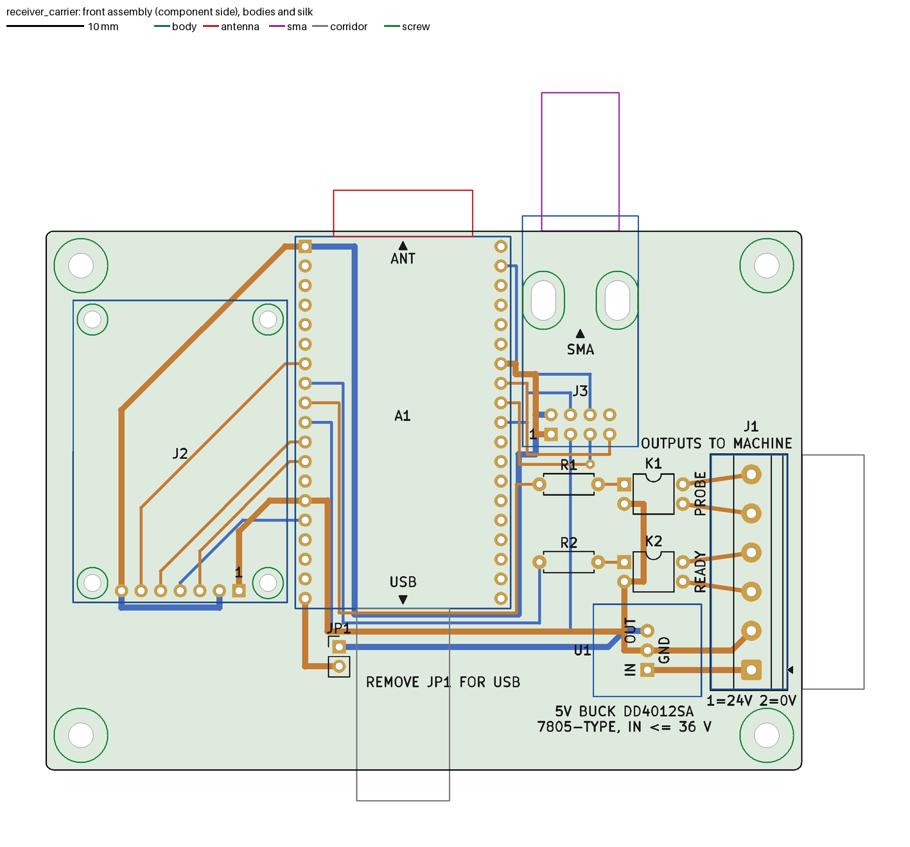
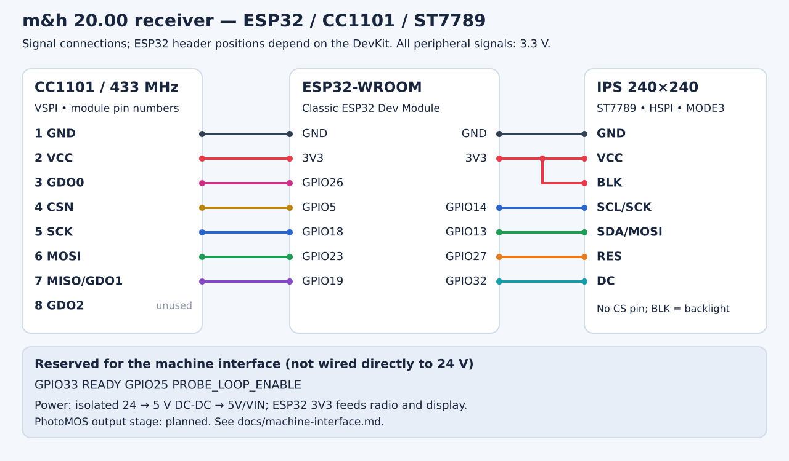

# m&h 20.00 receiver

A DIY receiver for the **m&h 20.00 wireless touch probe**, built from an ESP32-WROOM DevKit, a 433 MHz CC1101 radio and a 240×240 IPS display. It scans 433–435 MHz, finds the probe, detects contact and drives two PhotoMOS outputs (READY and PROBE) for a SINUMERIK 828D.

## Status

- **Breadboard prototype (P3-era firmware): works on hardware.** It picks up the probe, detects contact and shows the state on the display. See the [UART log and bench check](evidence/working/).
- **P4 carrier PCB: designed, not built.** 98 x 70 mm, 2 layers, all parts on the top side, everything hand soldered (no sockets, because the machine vibrates). It passes KiCad DRC (with schematic parity) and ERC, but has not been fabricated or assembled.
- **P4 firmware changes** (first CONTACT frame no longer dropped, timer-based output guard, task watchdog) pass the host tests, but have not yet been compiled with arduino-cli or run on hardware.
- **SINUMERIK 828D input side: not verified on the machine.**

Details: [testing status](docs/validation.md).



## Device photos


The white button on the mushroom-shaped top activates the probe. The black button near the battery sweeps the radio channels. The probe uses a 9 V PP3 (Krona) battery. [More photos and controls](docs/probe-behavior.md#physical-probe-and-controls).

## Wi-Fi updates

The receiver can start **MH-Probe-Service**, join your router, or do both. Use the web page for status, Wi-Fi settings and firmware uploads; UART commands can change or reset the settings too. The service login is **admin**, with a password printed over USB serial. Once the probe is detected, Wi-Fi switches off until the receiver restarts. [Setup and updates](docs/wifi-update.md).

## Display


Display previews rendered with the firmware's fonts and colors. The readings are examples.

| Color | Meaning | READY | Probe loop |
|---|---|---:|---|
| Red | No validated messages / search / error | 0 | Open |
| Green | Valid probe, free | 1 | Closed |
| Blue | Contact | 1 | Open |

The display holds blue for at least 100 ms so brief contacts are visible. The outputs update as soon as a contact frame is accepted. If no valid messages arrive for 65 ms, READY goes low and the probe loop opens.

## Power and USB

The P4 carrier uses a **non-isolated** DD4012SA 5 V buck module: machine 0 V is the logic GND. Only the two PhotoMOS output contacts are isolated. **With JP1 fitted, do not connect USB to a PC while the board is on machine 24 V.** Remove JP1 to power the board from USB on the bench. See [power](docs/power.md).

## Documentation

- [P4 carrier PCB](hardware/pcb/README.md): KiCad project, schematic, [BOM](hardware/pcb/bom.csv), Gerbers (`hardware/pcb/fab`), 1:1 prints (`hardware/pcb/print`) and check reports.
- [ESP32, CC1101 and LCD wiring](docs/wiring.md): pin tables and diagram.
- [Radio protocol](docs/protocol.md): FREE/CONTACT pulses, validation and acquisition.
- [Probe behavior](docs/probe-behavior.md): battery, buttons, channel sweep, activation and contact.
- [Wi-Fi and OTA updates](docs/wifi-update.md): service network, browser uploads and restart.
- [Build and upload](docs/build.md): Arduino IDE/CLI and dependency versions.
- [24 V power](docs/power.md) and [SINUMERIK 828D outputs](docs/machine-interface.md).
- [Testing status](docs/validation.md), [recorded test signals](fixtures/README.md).
- [Component references](hardware/pcb/components/README.md): specifications, pinouts, dimensions and drawings.

## Source and test data

- [Arduino sketch](firmware/probe_rx/probe_rx.ino): receiver firmware.
- [Protocol parameters JSON](protocol/probe.json), [wiring JSON](hardware/wiring.json).
- [Reference Python DSP](protocol/reference/): recording acquisition and demodulation.
- [Bench check](evidence/working/receiver-check.json).



## Run the tests

```powershell
python -m venv .venv
.\.venv\Scripts\python.exe -m pip install -r requirements-dev.txt
.\.venv\Scripts\python.exe scripts\test.py
```

Tests run on the computer without an ESP32 or SDR connected. The display test needs the Adafruit GFX 1.13.0 source; use `--gfx` to specify its location if it is not found automatically.

The full radio recordings are not included. The repository contains short excerpts for testing, with checksums.
