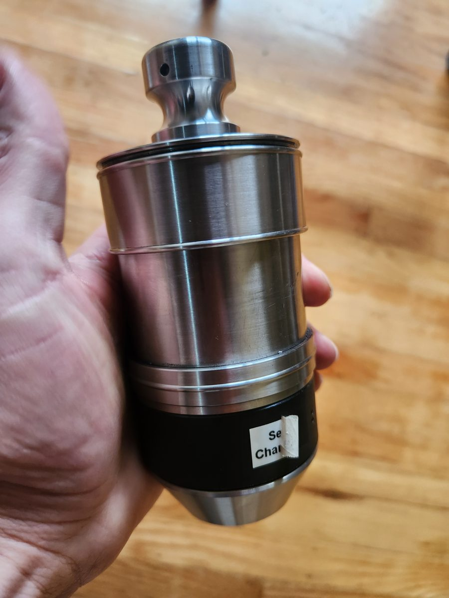
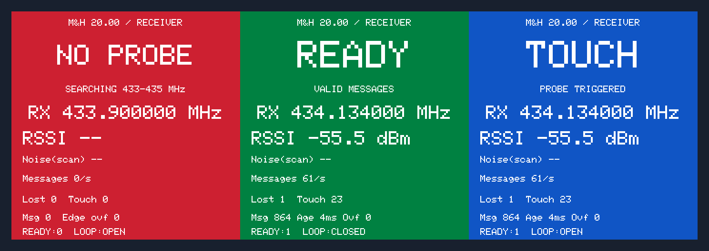
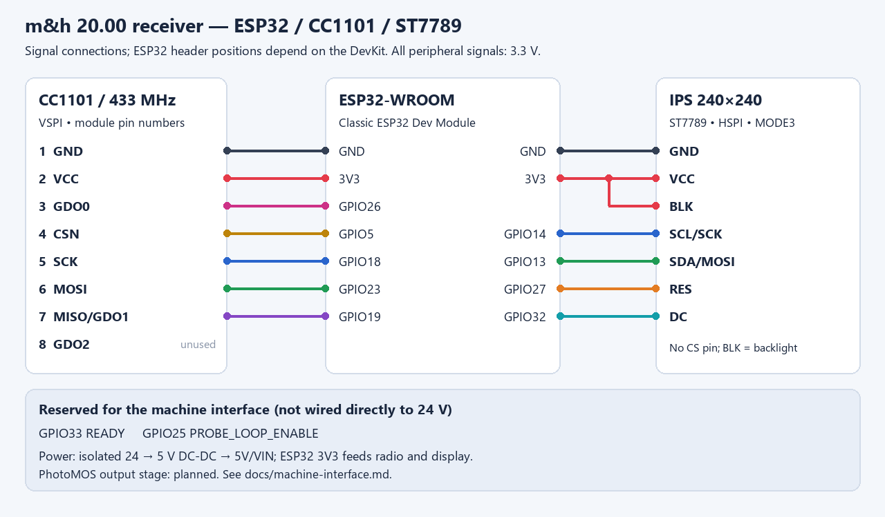

# m&h 20.00 — receiver prototype

A DIY receiver for the **m&h 20.00 wireless touch probe**, using an ESP32-WROOM, a 433 MHz CC1101 radio and a 240×240 IPS display. It scans 433–435 MHz, finds the probe and detects contact.

The receiver works on the bench: it picks up the probe, detects contact and shows its state on the display. The 24 V machine interface is not built yet. See [testing](docs/validation.md) for details.

## Device photos



The white button on the mushroom-shaped top activates the probe. The black button near the battery sweeps the radio channels. The probe uses a 9 V PP3 (Krona) battery. [More photos and controls](docs/probe-behavior.md#physical-probe-and-controls).

## Wi-Fi updates

At startup, connect to **MH-Probe-Service** and open **http://192.168.4.1/** for receiver status and firmware uploads. The password is printed over USB serial. Once the probe is detected, Wi-Fi switches off until the receiver restarts. [Setup and updates](docs/wifi-update.md).

## Display



Display previews rendered with the firmware's fonts and colors. The readings are examples.

| Color | Meaning | READY | Probe loop |
|---|---|---:|---|
| Red | No validated messages / search / error | 0 | Open |
| Green | Valid probe, free | 1 | Closed |
| Blue | Contact | 1 | Open |

The display holds blue for at least 100 ms so brief contacts are visible. The output GPIOs update as soon as a contact frame is accepted. If no valid messages arrive for 65 ms, READY goes low and the probe loop opens.

## Documentation

- [ESP32, CC1101 and LCD wiring](docs/wiring.md): numbered pin tables and diagrams.
- [Active message protocol](docs/protocol.md): FREE/CONTACT pulses, validation and acquisition.
- [Probe behavior](docs/probe-behavior.md): battery, buttons, channel sweep, activation, silence and contact.
- [Wi-Fi and OTA updates](docs/wifi-update.md): service network, browser uploads and restart.
- [Build and upload](docs/build.md): Arduino IDE/CLI, dependency versions and firmware compilation.
- [24 V → 5 V power](docs/power.md) and [SINUMERIK 828D outputs](docs/machine-interface.md).
- [Tests and remaining work](docs/validation.md), [recorded test signals](fixtures/README.md).

## Source and test data

- [Arduino sketch](firmware/probe_rx/probe_rx.ino): receiver firmware.
- [Protocol parameters JSON](protocol/probe.json), [wiring JSON](hardware/wiring.json).
- [Reference Python DSP](protocol/reference/): recording acquisition and demodulation.
- [Bench test log](evidence/working/receiver-check.json).



## Run the tests

```powershell
python -m venv .venv
.\.venv\Scripts\python.exe -m pip install -r requirements-dev.txt
.\.venv\Scripts\python.exe scripts\test.py
```

Tests run on the computer without an ESP32 or HackRF connected. The display test needs the Adafruit GFX 1.13.0 source; use `--gfx` to specify its location if it is not found automatically.

The full radio recordings are stored separately. This repository includes short excerpts for testing, with source details and checksums.
