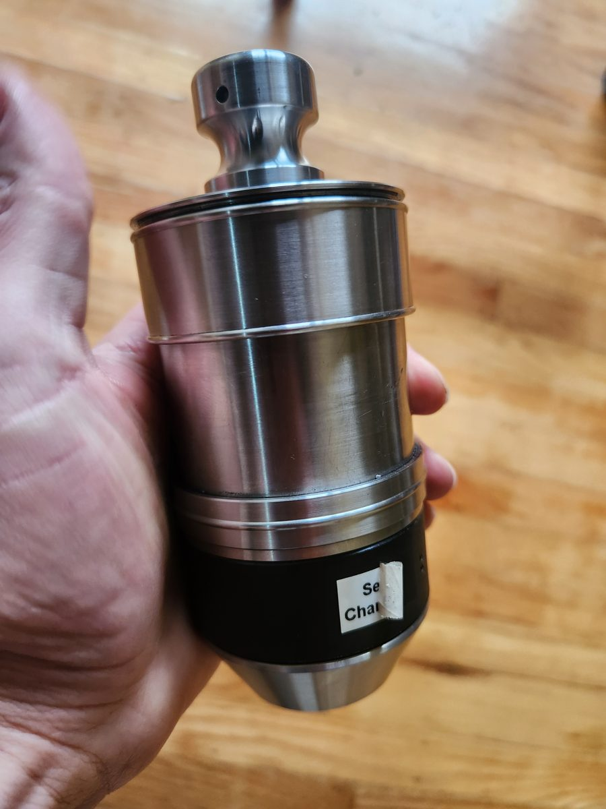
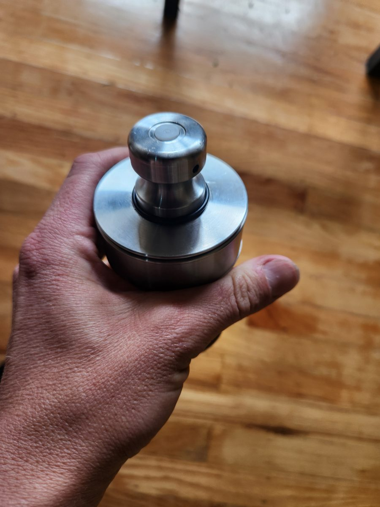
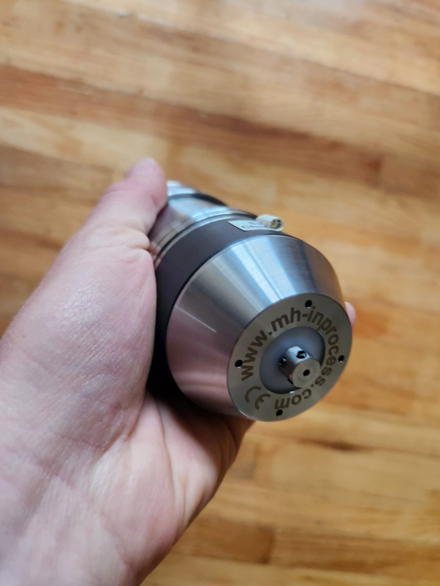
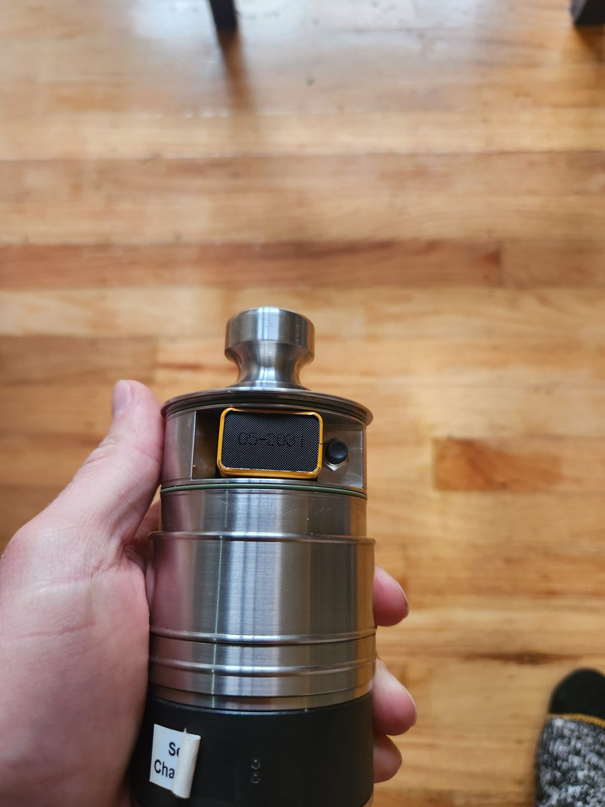

# Probe behavior

This page describes what the probe does on the bench and in radio recordings. Some startup and control signals are still undecoded.

| Action / condition | Observed RF behavior | Evidence |
|---|---|---|
| Insert battery | Very short broadband streak lasting a few milliseconds | Visible on the spectrogram; not decoded. May include transmitter startup or power-related interference |
| Probe inactive | No active message stream | The sleep timeout is unknown |
| Brief channel-button press | Short burst near the current/new frequency | Visible on the spectrogram; individual control bursts remain undecoded |
| Hold channel button | Carrier forms a frequency staircase, around 25 kHz per step | Confirmed in SDR++ WAV: 14 stable frequencies with the same FREE pattern |
| Press activation button | Continuous transmission on the selected frequency; a broad halo on the spectrogram | IQ confirms the repeating four-pulse FREE pattern. The 433–435 MHz halo's cause was not measured separately |
| Touch an active probe | Frequency and average power remain similar | Fourth pulse moves from 3640 to 3120 µs: CONTACT |
| Release | Transmission continues | Fourth pulse returns to 3640 µs: FREE |
| Stop receiving the probe | No valid new messages | After 65 ms the receiver drops READY and opens the loop. The receiver cannot tell whether the probe is off, asleep or out of range |

## Physical probe and controls

| Part | Function |
|---|---|
| White button on the mushroom-shaped top | Activates the probe |
| Black button near the battery | Sweeps the radio channels; holding it produces the observed frequency staircase |
| Battery | 9 V PP3 (Krona) |

### Overall view



### Activation button



Press the white button on top to activate the probe. Use the black button near the battery to sweep channels. The battery compartment is closed in these photos.

### Stylus end



### Side view



## Frequency sweep

The sweep recording is 42.500096 s long, sampled at 2 million complex samples/s with a center frequency of 433.912004 MHz.

Stable steps last approximately **2.5 s** in that recording. Measured upper-tone positions in Hz:

```text
433721391 433746355 433796281 433821275 433846239 433871202 433896165
433946336 433971330 433996294 434021257 434046220 434096178 434121110
```

These are the upper FSK tone positions on the SDR frequency scale, not calibrated factory channel centers. The step is approximately 24.963 kHz, with some roughly 50 kHz jumps. It is unclear whether the larger jumps come from skipped channels or the recording.

Replaying the full recording decoded **2014 messages**, with no contact transitions, across all 14 frequencies. The [channel-hop test recording](../fixtures/README.md) covers the transition between the first two steps.

An earlier 90-second CS8 recording intended to capture a sweep contained background without decodable frames. The later WAV recording captures the sweep as a frequency staircase.

## Activation and pairing

The prototype receives FREE and CONTACT messages without the original receiver, pairing or transmitting commands. Startup bursts and commands from the original receiver have not been decoded.

## Contact timing

The contact recording contains three touches. First CONTACT frames begin approximately at 5.42556, 12.10912 and 17.38416 s; FREE returns at 7.73312, 13.81544 and 19.513 s. A separate recording contains one held contact.

These times mark radio frames, not the instant the stylus touched the surface. Without a separate contact measurement, they cannot be used to calculate sensor latency. The test excerpts include the first contact and release; bounce and debounce still need checking.

See [protocol.md](protocol.md) for pulse timing.
