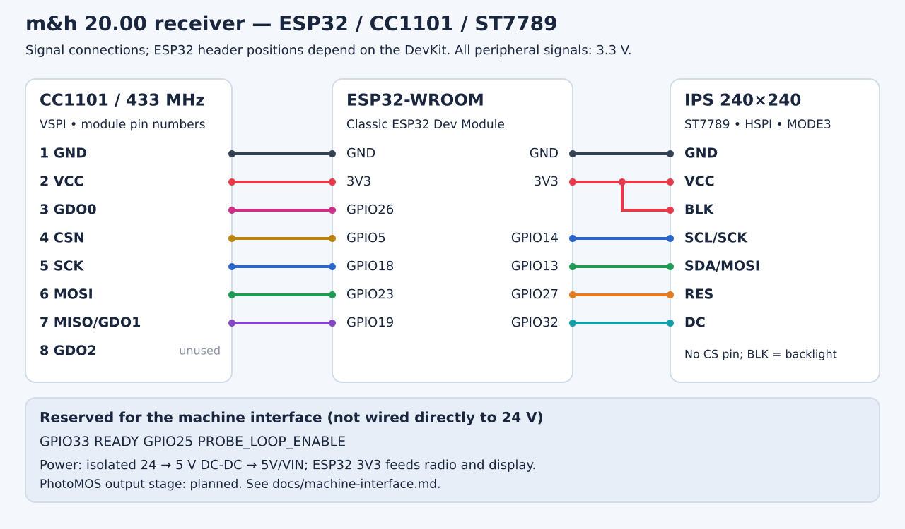
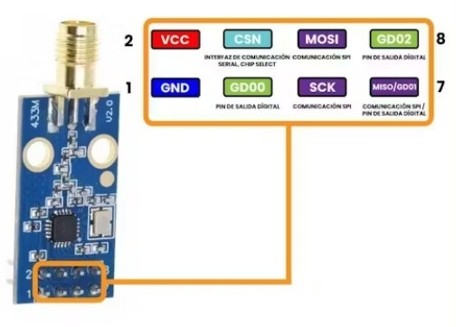

# Wiring

The receiver uses a classic ESP32-WROOM DevKit (ESP32-DevKitC V4 on the carrier), a 433 MHz CC1101 module and a seven-pin, ST7789-compatible IPS 240×240 display. The display works in **hardware SPI MODE3**. The diagram shows signal connections. Header positions vary between DevKit boards.

[Machine-readable wiring](../hardware/wiring.json)

## CC1101

Pin numbers follow the numbered Ebyte component-side drawing and pin table; the pinout image below agrees with them. On the carrier, J3 pin n is module pin n.

| Module pin | CC1101 signal | ESP32 |
|---:|---|---|
| 1 | GND | GND |
| 2 | VCC | 3V3 |
| 3 | GDO0 | GPIO26 |
| 4 | CSN | GPIO5 |
| 5 | SCK | GPIO18 |
| 6 | MOSI | GPIO23 |
| 7 | MISO / GDO1 | GPIO19 |
| 8 | GDO2 | Leave disconnected |

In the picture's orientation, the top row is **2, 4, 6, 8** and the bottom row is **1, 3, 5, 7**. Looking from the opposite side mirrors this arrangement.

The CC1101 uses VSPI and provides asynchronous demodulated data on GDO0. Use an antenna intended for 433 MHz; an ordinary Wi-Fi antenna is not matched to this band.

## Display

On the carrier the display plugs into J2 (pin numbers below).

| J2 pin | LCD pin | ESP32 |
|---:|---|---|
| 1 | GND | GND |
| 2 | VCC | 3V3 |
| 3 | SCL / SCK | GPIO14 |
| 4 | SDA / MOSI | GPIO13 |
| 5 | RES | GPIO27 |
| 6 | DC | GPIO32 |
| 7 | BLK / BL | 3V3 |

SCL/SDA on this module are **SPI signals**, despite their I²C-like names. This seven-pin module has no CS pin. It uses a separate HSPI bus: 1 MHz initialization, 20 MHz drawing, rotation 0 (on the carrier the display is mounted with its header at the bottom). If long wires cause pixel corruption, DRAW_HZ can be reduced to 10 MHz. 20 MHz works on the prototype.

All three devices share GND and 3.3 V. See [power.md](power.md) for the 24 V supply.

## Machine outputs

| GPIO | Signal | Carrier path | J1 pins |
|---:|---|---|---|
| 33 | READY | R2 150 ohm → K2 AQY212EH | 3 / 4 (READY_A / READY_B) |
| 25 | PROBE_LOOP_ENABLE | R1 150 ohm → K1 AQY212EH | 5 / 6 (PROBE_A / PROBE_B) |

J1 pins 1 and 2 are 24 V in and 0 V. The GPIOs are 3.3 V signals that drive the PhotoMOS LEDs only. See [machine-interface.md](machine-interface.md) for the contacts, polarity and the machine connection.

[Component dimensions and drawings](../hardware/pcb/components/README.md).
