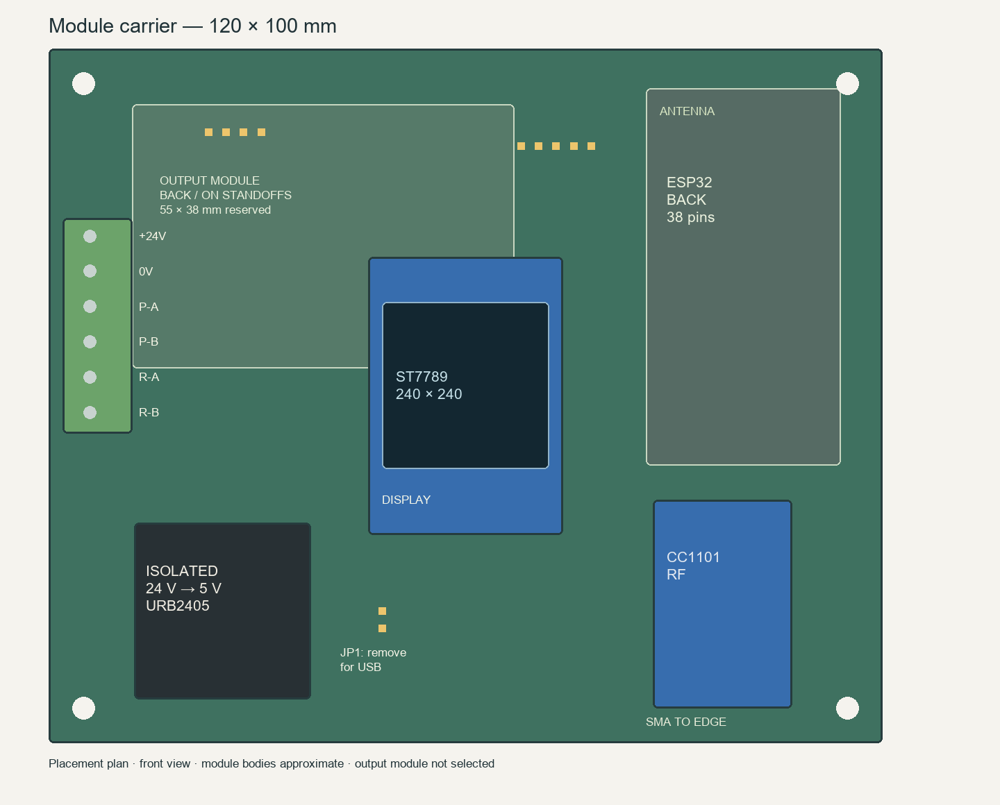

# Module carrier

A 120 x 100 mm, two-layer carrier for the existing receiver modules. The display is centered on the front. The ESP32 is soldered directly to the back, with 19 pins per row, 2.54 mm pitch and 25.4 mm between rows. The six-way screw terminal faces the left edge.

Open `receiver_carrier.kicad_pro` in KiCad 10. The project includes the schematic, routed PCB, local module symbols and footprints, and `bom.csv`. [Copper and placement drawing](preview/placement.svg) · [Schematic](preview/schematic/receiver_carrier.svg).

This is a prototype layout, not a fabrication release. The ready-made output module has not been selected. Display and radio body sizes are approximate; check the purchased modules and pin numbering before ordering a board.

## Parts

| Reference | Part | Purpose |
|---|---|---|
| A1 | Existing 38-pin ESP32 board | Receiver firmware, display, Wi-Fi |
| U1 | Hi-Link URB2405YMD-6WR3 | Isolated 24 V to 5 V supply |
| J2 | Existing seven-pin ST7789 display | Front-center display |
| J3 | Existing CC1101 module | Probe radio |
| EXT1 | Complete two-channel DC photorelay module, still to select | PROBE and READY dry contacts |
| J1 | Six-way 5.08 mm screw terminal | Machine wiring |
| J4, J5 | Five-pin and four-pin headers | Short wires to the output module |
| JP1 | Two-pin header and shunt | Disconnect the converter output for USB power |

There are no separate resistors, capacitors, transistor drivers or ferrite beads on the carrier. Input conditioning belongs inside the complete output module. Four 3.2 mm holes mount the carrier; output-module mounting holes will be added after its dimensions are known.

## Machine connector

J1 runs from top to bottom in the front view:

| Pin | Signal |
|---|---|
| 1 | +24 V input |
| 2 | Machine 0 V |
| 3, 4 | PROBE contact A, B |
| 5, 6 | READY contact A, B |

Use an upstream fused 24 V supply. Machine 0 V and receiver GND are separate nets. The four contact wires are floating. The converter's component isolation rating does not establish an isolation rating for the assembled carrier. Connecting USB can introduce an external ground path.

Remove the JP1 shunt before powering the ESP32 through USB. Refit it for standalone 24 V operation.

## Module connections

Display header order: GND, VCC, SCL, SDA, RES, DC, BLK. VCC and BLK connect to 3.3 V. GPIO14 drives SCL, GPIO13 SDA, GPIO27 RES and GPIO32 DC. The footprint assumes a 2.54 mm header and an approximate 28 x 40 mm body; check both against the actual display.

CC1101 header: 1 GND, 2 3.3 V, 3 GDO0/GPIO26, 4 CSN/GPIO5, 5 SCK/GPIO18, 6 MOSI/GPIO23, 7 MISO/GPIO19, 8 unused. Confirm the module's physical pin numbering. Orient its antenna connector toward the lower edge. No carrier copper is routed in the marked antenna areas.

The output module mounts behind the upper-left area on insulated standoffs, clear of solder joints and display pins. The 55 x 38 mm rectangle reserves space; it is not a verified vendor footprint. J4 pin 1 is +5 V, 2 GND, 3 PROBE/GPIO25, 4 READY/GPIO33, 5 +3.3 V. Use the supply pin appropriate to the module. J5 pins 1-2 are PROBE A/B and 3-4 READY A/B.

The output module must provide two independent normally-open DC contacts, support 3.3 V active-high control with inputs held off during ESP32 reset, and contain its own input resistors/drivers. A TLP222A-based board is preferred. Target at least 30 V / 50 mA contact capability and no more than 0.5 ms turn-off time; check leakage against the machine input. An AC-only or zero-cross SSR board does not suit this interface. A bare TLP222A cannot plug into J4/J5.

## Power footprint

U1 uses the manufacturer's top-view pin drawing: 1 -Vin, 2 +Vin, 3 +Vout, 5 output GND; 4 is not populated and 6 is unused. The converter body is 25.4 x 25.4 mm. Check the label and pins on the supplied part before assembly.

Sources: [Hi-Link product page](https://www.hlktech.net/index.php?cateid=760&id=1299), [manufacturer datasheet](https://drive.google.com/file/d/1KfvgmW3_NbNLIYul3vVTS3nYDesQEoOc/view), [Espressif reference dimensions](https://dl.espressif.com/dl/schematics/esp32_devkitc_v4_dimensions.pdf).

## Checks and regeneration

KiCad ERC and PCB DRC pass with zero violations and zero unconnected items. The schematic netlist is compared with every connected PCB pad by `verify_connectivity.py`. These checks cover carrier connectivity and default KiCad clearances; the functional module symbols use passive pins, so ERC does not validate module voltage ratings, output timing, EMC or the machine interface. Those require checking the selected modules and testing the assembly.

Run `generate_carrier.py` using KiCad's bundled Python. It reads `design.json` and restores the saved track geometry from `routes.json`. That geometry belongs to this placement: changing pad positions requires rerouting and fresh checks. The initial tracks were produced locally with [Freerouting](https://github.com/freerouting/freerouting), then checked in KiCad. Run `render_placement.py` with Pillow to redraw the placement plan.

No fabrication Gerbers are included while the output module and mechanical fit remain unresolved.
